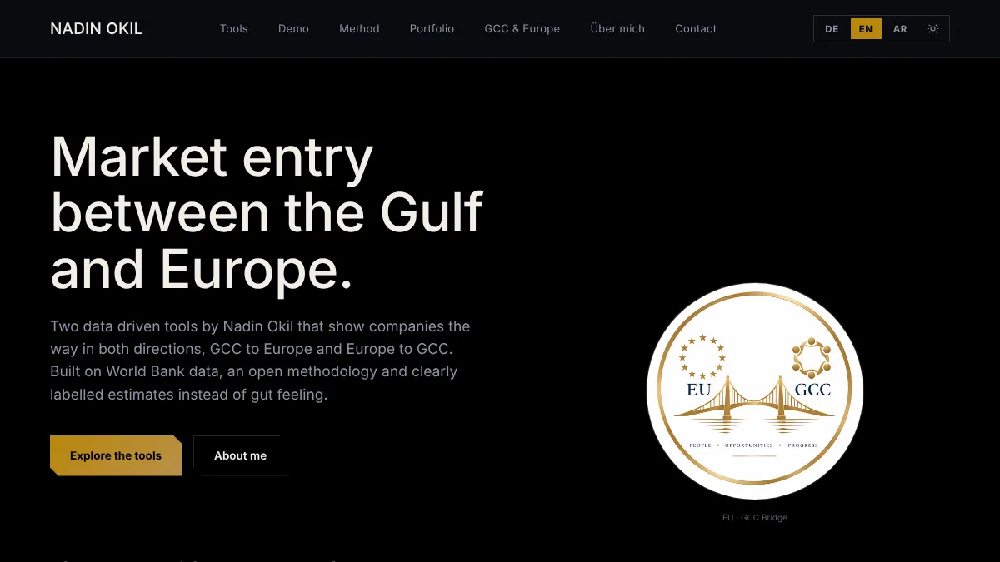

# GCC and Europe Market Entry

**Live:** https://market-entry.nadin.dev

Two decision tools in one website: **GCC Market Entry** (a European company entering the Gulf) and **Europe Market Entry** (a Gulf company entering Europe). Both analyse a company profile or an uploaded PDF and produce a scored market entry plan.



**Portfolio:** https://portfolio.nadin.dev
**Tool:** https://market-entry.nadin.dev

## What it does

- Hub with a choice between the two tools. The first visit opens in demo mode: sample data is pre filled, no login, no account.
- Analysis of a company profile or a PDF (text layer or scan), with charts, a ranked list and a plan as PDF.
- Optional account to save plans (Supabase). Without an account the data stays in the browser.
- German, English, Arabic (right to left), light and dark theme.

## How it works

- `market-entry/` is a Vite and React single page app (React 18, Tailwind 3). The shell and routing are in `src/Root.jsx`, the two tools in `src/tools/gcc` and `src/tools/europe`, shared texts in `src/dataI18n.js`.
- `src/backend.js` is the only place that talks to Supabase. Security relies on Row Level Security (`supabase/schema.sql`). Only the publishable key is in the frontend, a service role key is never part of this project.
- Without a Supabase configuration the same code stores plans in the browser instead. Nothing else changes.
- Tests are in `market-entry/tests/` (login matrix, row level security checks, sandboxed preview).
- `portfolio/` is the static portfolio page for this project. `demo-pdfs-zum-testen/` holds two fictional demo PDFs for the PDF scanner, one per tool.

## Run it

Needs Node.js 18 or newer.

```bash
cd market-entry
npm install
npm run dev
npm run build      # output in dist/
```

## Configuration

The repository holds two apps: `market-entry` (the tool) and `portfolio` (the overview page). Optional environment variables: `VITE_LEGAL_EMAIL`, `VITE_SUPABASE_REGION`, `VITE_HOSTING_PROVIDER`. The optional account backend is described in `market-entry/SETUP-SUPABASE.md`.

Built by Nadin Okil.
